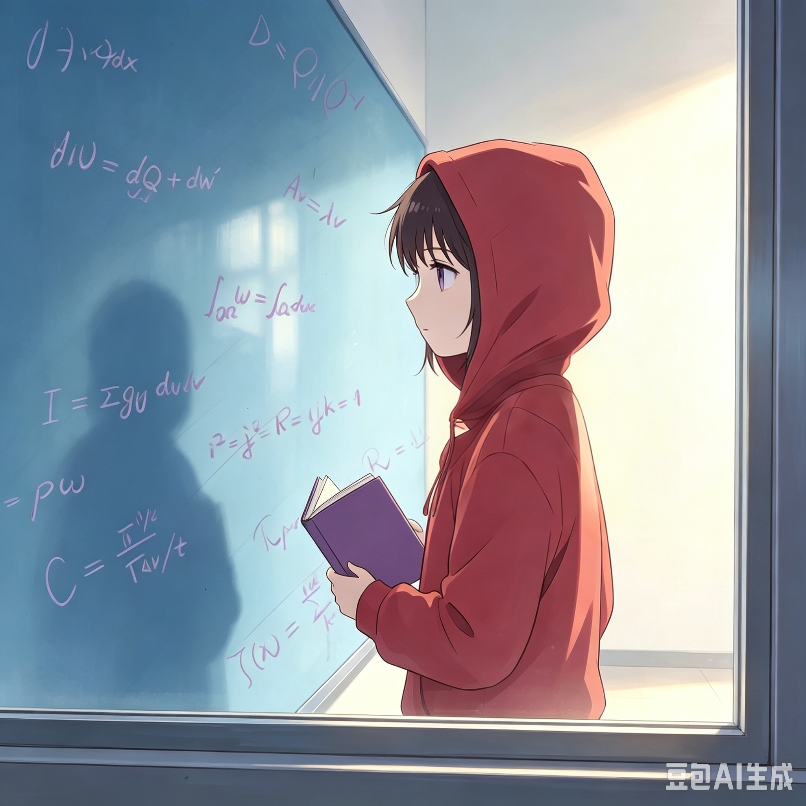

<html lang = "zh-CN">
<head>
  <meta charset = "utf-8"/>
  <meta name = "theme-color" content = "#7f007f"/>
  <title>📍注意看左边的图标哦</title>
  <link rel="icon" type="image/jpg" href="icon.jpg">
  
</head>
<body>
  

    
  

  
「这就开始啦╰(*°▽°*)╯」

  
这是雪冰冬晨的自我介绍页面

  

  

    
  

  
我曾经画过自己的一张自画像， 这是豆包参考那张图画出来的。 在阳光洒落一方光影的虚室里， 一个人更容易直面深邃的真相。

  
(1)　我是谁？

  
我是北京大学工学院 2026 级的一名本科生。

  
我的家乡，坐落在浙江西南，一个普普通通的小山城里。 远山如黛，带来一方澄明，却也隔绝着未至之境的讯息。 于是，我从小就想走出山城，在更大的世界里探索新知。

  
(2)　我有什么想法呢？

  
说起爱好，我与其他人很不一样。

  
很多人喜欢抽出大把大把的时间运动、旅游、购物； 但是，我对物质生活与娱乐活动没有什么大的需求。 我喜欢的是，周末去图书馆翻出一些奇奇怪怪的书， 或者是打开微软办公与必剪，做些自己的版面设计。
  
  
这是因为，我不仅对很多领域感到好奇，还喜欢自己研究探索它们。 而且我的爱好特别广泛：从几何、物理、化学，一直到语言与文字。 大学企图用分专业的方式，将我们层层细分，引入纵深的钻研之中。 但即使是工院这样复合的地方，应该也接不住我这样广谱的兴趣呢。

  
在这样一个追求精深与实践的时代，我还不够清楚自己能做些什么。 但或许，我虽然不能在一方领域内臻于至善，但还是可以博采众长， 凭借广泛涉猎学习，汇成自己一家之言，为世界提供一份新视角呢。

  
编辑、图源：雪冰冬晨 代码块帮助：豆包

  

    
  

  

    
  

  

    <button id="click1">点击查看我的哔站主页</button>
  

  

    <button id="click2">点击查看我的维康主页</button>
  

  

  
</body>
</html>
